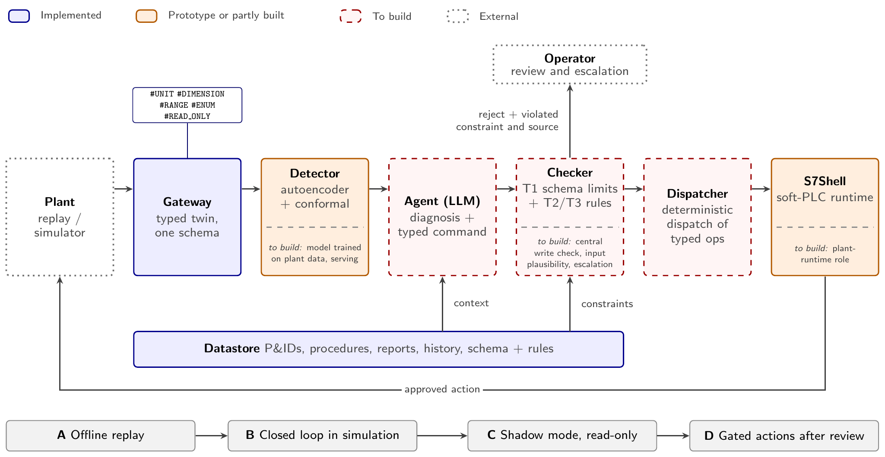

# SGRN

[](https://github.com/Kahoul-Ibrahim-El-Khalil/SGRN/actions/workflows/ci.yml)

**SGRN** is an open-source C++ and Python framework that connects industrial control systems to AI through one typed, schema-driven model of the plant. It provides a multi-protocol gateway with a digital twin, a soft-PLC and plant simulator, and tools for storing, replaying and analysing plant data.

SGRN eliminates the brittle, manual byte-offset mapping common in industrial telemetry integration by using **declarative SCL (Structured Control Language) schemas as the single source of truth**. The same schema gives every signal its name, unit, range and permitted operations, so that AI systems built on top can be checked against it.



*Blue boxes exist today, orange are prototypes, red dotted are to build, and gray dotted (plant, operator) are external to the project.*

> [!TIP]
> **Research experiments:** for plant anomaly detection, split-conformal uncertainty quantification and the pipeline orchestrator, see [**`experiments/`**](./experiments/README.md) and [**`experiments/flare/`**](./experiments/flare/README.md).

---

## Status

| Works today | Not built yet |
|:---|:---|
| Gateway with typed digital twin and embedded web dashboard | LLM agent |
| Datastore (storage of documents and datasets)              | Indexing of documents, Checker and dispatcher                          |
| S7Shell soft-PLC and plant simulator | S7Shell as the runtime through which approved actions reach a plant |
| Autoencoder and split-conformal detector (simulated data) | Validation on a live plant |

All results so far use simulated plant data and Siemens PLCSIM Advanced. SGRN has not been validated on a live plant.

---

## Key Capabilities & Objectives

- **Declarative memory coupling:** parses Siemens S7 SCL schemas into dynamic memory maps and protocol ASTs, removing hardcoded byte offsets from edge middleware.
- **Protocol convergence:** ingests and normalizes multi-protocol telemetry (Siemens S7, Modbus, OPC-UA, HTTP/JSON, WebSockets) into an in-memory shadow digital twin.
- **Deterministic edge execution:** an AngelScript-driven soft-PLC (`s7shell`) executes control logic, simulates thermodynamic processes and enforces safety interlocks with low-latency, predictable timing.
- **High-throughput write-ahead logging (WAL):** records atomic state changes into compressed Zstandard archives for loss-tolerant edge buffering and exact historical replay.
- **Uncertainty-aware ML:** PyTorch autoencoders with split-conformal calibration (`sgrn.ml`) detect process drift. The conformal guarantee assumes exchangeable data, which industrial time series only approximate.

---

## Codebase Architecture

The repository is organized into distinct, cohesive layers:

```
SGRN/
├── sgrn/                       # Core C++ libraries and runtime modules
│   ├── apps/                   # Executable entry points (gateway, s7shell, replay, dataset)
│   ├── lib/
│   │   ├── scl/                # Industrial SCL schema AST parser and memory layout generator
│   │   ├── gateway/            # Shadow memory digital twin, policy engine, OPC-UA/HTTP/WS hub
│   │   ├── s7shell/            # AngelScript soft-PLC runtime and process simulator
│   │   ├── datastore/          # Resilient time-series buffer and storage adapters
│   │   ├── scripting/          # AngelScript C++ bindings and sandboxing
│   │   ├── core/ & utils/      # Thread pools, allocators, IPC, and logging
│   │   └── sdk/                # C++ client SDK for external IT integrations
│   └── python/                 # Python package (sgrn)
│       ├── gateway.py          # Python client bindings for the gateway REST/WS APIs
│       └── sgrn/ml/            # Manifold ML, device abstraction, conformal UQ, and pipelines
├── experiments/                # Research benchmark suite & pipeline orchestrator
│   ├── flare/                  # Self-contained gas dehydration & blocked-flare experiment
│   └── orchestrate.py          # Pipeline orchestrator (ingestion -> training -> evaluation)
├── demos/                      # Interactive gateway scenarios, soft-PLC simulations, and live twins
├── documentation/              # Technical specifications, build manuals, and architecture guides
└── actions/ & scripts/         # Automated database setup, web packaging, and code generation
```

---

## Core Utilities & Binaries

Building the project produces several core binaries:

| Utility | Description | Primary Role |
|:---|:---|:---|
| **`gateway`** | Real-time telemetry hub | Ingests PLC telemetry into a mutex-protected shadow digital twin; exposes OPC-UA, WebSockets and HTTP APIs; enforces security policies; serves embedded web dashboards. |
| **`s7shell`** | Soft-PLC & scripting engine | Runs AngelScript against shadow memory; executes process physics and PDU-optimized read/write batching. |
| **`sgrn_replay`** | WAL replayer | Replays compressed `.jsonl.zst` or `.bin.zst` archives into running gateways with adjustable speed and pacing. |
| **`sgrn_dataset`** | Feature extraction tool | Decodes raw write-ahead logs against an SCL schema into CSV/Parquet datasets for ML pipelines. |
| **`datastore`** | Edge persistence engine | Buffers, spools and forwards telemetry to PostgreSQL or S3-compatible storage. |

---

## Primary Use Cases

### 1. Unified multi-protocol edge convergence
Factories often have separate protocol silos (S7 for PLCs, Modbus for ancillary sensors, OPC-UA for SCADA). SGRN serves as a single edge hub: it ingests heterogeneous streams, normalizes them into one shadow memory, and projects the state over standard REST, WebSocket or OPC-UA endpoints.

### 2. Declarative PLC integration (no recompilation)
When an automation engineer updates a PLC DataBlock (for example adding a sensor or changing a UDT), traditional gateways need code updates, offset recalculation and redeployment. With SGRN, the engineer updates the `.scl` schema, and the runtime updates memory offsets, REST routes and OPC-UA node hierarchies without recompiling or restarting edge services.

### 3. Edge soft-PLC control
Instead of streaming high-frequency data to a remote server for simple control decisions, `s7shell` runs AngelScript scripts directly against shadow memory and batches writes into PDU-optimized packets, for edge-level interlocks and closed-loop control.

### 4. Resilient edge historian and replay
During network partitions, SGRN buffers process updates into compressed write-ahead logs (`.zst`). When connectivity returns, data streams forward without gaps. Past incidents can be replayed into a twin gateway with `sgrn_replay`.

### 5. Plant supervision research
Coupling SGRN's telemetry with `sgrn.ml` enables unsupervised manifold anomaly detection. By extracting multi-dimensional process trajectories and calibrating non-conformity scores with split-conformal prediction, the detector flags faults early. In the simulated blocked-flare scenario it raises a warning well before the simulated shutdown (see `experiments/flare/`).

### 6. Embedded observability
Both `gateway` and `datastore` embed compiled web dashboards (Svelte/React, compressed with Zstandard, baked into C++ binary headers). Pointing a browser at the gateway gives live visibility without external dependencies or cloud connectivity.

---

## Building SGRN

SGRN uses **CMake Presets** and a unified build environment managed with **Micromamba**.

### Prerequisites
- Linux x86_64 (Ubuntu 22.04+ or a modern Linux distribution)
- [Micromamba](https://mamba.readthedocs.io/en/latest/installation/micromamba-installation.html) or Conda

### 1. Clone the repository
```bash
git clone <repository-url>
cd SGRN
```

> [!NOTE]
> SGRN has **no Git submodules** — ignore any old instructions to run `git submodule update`. All third-party source dependencies are fetched automatically by [CPM.cmake](https://github.com/cpm-cmake/CPM.cmake) into `.cpm-cache/` during the CMake configure step below.

### 2. Initialize the build environment
The environment files in `micromamba/` provide compilers (GCC/Clang), Ninja, CMake, and the packaged C++ libraries in an isolated prefix:

```bash
# Create and activate the primary Linux development environment:
micromamba create -f micromamba/SGRN.yml
micromamba activate SGRN
```

### 3. Build and install via CMake Presets

Run all builds with the `SGRN` environment activated. Presets are defined in `CMakePresets.json`.

First, build and install the dependencies that come as source code:

```bash
# Downloads and configures all CPM-fetched dependency sources:
cmake --preset linux-deps-static

# Compiles them and installs libraries into .prefix/linux-static/:
cmake --build --preset linux-deps-static
```

Second, build the project itself:

```bash
# Configure using the Linux static-release preset:
cmake --preset linux-static-release

# Build all SGRN components:
cmake --build --preset linux-static-release

# Optional: install binaries and headers into .dist/:
cmake --build --preset linux-static-release --target install
```

> [!NOTE]
> For the full two-phase build workflow, build options, and cross-compilation (Windows / ARM64), see [**`documentation/BUILD.md`**](./documentation/BUILD.md).

> [!NOTE]
> For cross-compiling to **Windows** (`linux-to-win64`) or **ARM64** (`linux-to-arm64`), see [**`documentation/BUILD.md`**](./documentation/BUILD.md).

---

## Quick Verification & Demos

### Run the interactive gateway demo
To verify the build, list and launch one of the built-in simulated plants (soft-PLC skids). The data comes from the simulator, not from a live plant:

```bash
python3 demos/gateway.py --list
python3 demos/gateway.py simple_skid
```

Open the embedded dashboard at `http://localhost:8000/`, or use the native UI that the launcher opens.

**If the gateway does not start:** in this scenario `s7shell` and the gateway talk over the S7 protocol on port 102, which is a privileged port on Linux. Either run the demo with elevated rights:

```bash
sudo python3 demos/gateway.py simple_skid
```

or allow unprivileged programs to bind ports from 102 upward until the next reboot, then run the demo normally:

```bash
sudo sysctl -w net.ipv4.ip_unprivileged_port_start=102
python3 demos/gateway.py simple_skid
```

### Run the anomaly-detection experiment
To run the end-to-end plant anomaly-detection experiment on simulated data, with live progress:

```bash
python3 experiments/flare check
python3 experiments/flare run --output-dir scratch/quick_test
```

---

## License

This project is licensed under the **GNU Affero General Public License v3 (AGPLv3)**. See the [`LICENSE`](./LICENSE) file for details.
