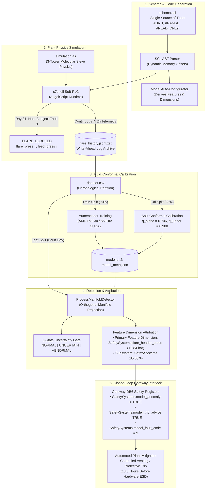

# SGRN Autonomous Plant Supervision Experiments

This directory contains the primary research experiments demonstrating **Trustworthy AI for Autonomous Plant Operations** through schema-driven physics-constrained manifold anomaly detection, split-conformal uncertainty quantification, and gated supervisory control.

---

## Architecture & End-to-End Execution Flow

The experiment realizes a complete closed-loop cyber-physical stack:



---

## Quickstart

From the repository root:

```bash
python3 experiments/flare check          # deps, config, bundled WAL, binaries
python3 experiments/flare run            # full 5-stage pipeline (default: experiments/flare/)
python3 experiments/flare evaluate       # offline metrics + plot
python3 experiments/flare demo           # live replay (template advisories, no API key)
```

Custom output directory or fresh simulation capture:

```bash
python3 experiments/flare run --output-dir scratch/my_experiment_run --epochs 40
python3 experiments/flare run --capture   # slow: rebuild flare_history.jsonl.zst
```

See [`experiments/flare/README.md`](./flare/README.md) for architecture and metrics.

The orchestrator executes and displays live progress bars for:
1. **[1/5] Process Telemetry & WAL Ingestion** (`flare_history.jsonl.zst`)
2. **[2/5] SCL Schema Parsing & Sliding Window Extraction** (`dataset.csv`)
3. **[3/5] Manifold Autoencoder Training & Split-Conformal Calibration** (`model.pt`, `model_meta.json`)
4. **[4/5] 742-Hour Timeline Evaluation & Dimensional Attribution** (`evaluation_plot.png`, `evaluation_metrics.json`)
5. **[5/5] Executive Diagnostic Report Generation** (`report.md`)

All generated artifacts (`dataset.csv`, `model.pt`, `model_meta.json`, `evaluation_plot.png`, `evaluation_metrics.json`, `report.md`) are written to the selected `--output-dir`.

---

## Step-by-Step Lifecycle Guide: Granular Execution

### Phase 1: Declarative Schema Definition & Code Generation

The industrial SCL schema acts as the **single source of truth** for both the PLC memory layout and the AI model architecture:

```scl
// sgrn/lib/gateway/simulations/gas_processing/schema.scl
DATA_BLOCK "SafetySystems" DB 6 #LITTLE_ENDIAN
VAR
    flare_header_press : Real #UNIT("bar");  // Physical measurement tag
    model_anomaly      : Bool;               // Model feedback indicator
    model_trip_advice  : Bool;               // Checker-gated interlock
    model_fault_code   : Word;               // Diagnosed fault (9 = FLARE_BLOCKED)
END_VAR
```

- **Memory Layout Generation**: The SCL parser computes memory byte-offsets, Endianness, and JSON symbol ASTs automatically.
- **Automated Model Topology**: `configureModelFromSchema()` derives continuous feature inputs, neural layer dimensions ($W \cdot S \to 64 \to 16 \to 64 \to W \cdot S$), and categorizes signals into physical domains (**Pressure**, **Temperature**, **Flow**, **Level**, **Vibration**, **Energy**) without hardcoding.

---

### Phase 2: Plant Physics Simulation & Telemetry Capture

The soft-PLC simulation executes continuous process physics at 1 Hz inside `s7shell`:

- **Process Physics**: A 3-tower molecular sieve dehydration plant (adsorption, thermal regeneration at $290^\circ\text{C}$, cooldown at $<50^\circ\text{C}$).
- **Continuous Archive**: Runs for 31 days (742 simulation hours), recording all plant state transitions into compressed WAL archives.
- **Fault Injection**: At Day 31, Hour 3, fault code 9 (`FLARE_BLOCKED`) is injected: the flare header outlet flow drops to zero, causing backpressure to build up toward plant trip limits.

```bash
# Capture fresh 31-day simulation history (optional; pre-captured WAL archive is included):
python3 experiments/flare/run_capture.py
```

---

### Phase 3: Dataset Processing & Normalization

Extracts tabular telemetry and creates chronological splits to guarantee **zero temporal data leakage**:

```bash
# Slices pre-fault nominal baseline (70% train, 30% calibration) and post-fault test data:
python3 -c "
import sgrn.ml as ml
import pandas as pd
df = pd.read_csv('experiments/flare/dataset.csv')
print('Loaded dataset with', len(df), 'timesteps across', len(df.columns), 'signals')
"
```

1. **`train_raw`**: First 70% of nominal baseline (fitted for Z-score `Scaler` statistics: $\mu, \sigma$).
2. **`cal_raw`**: Held-out 30% of nominal baseline (isolated for statistical calibration).
3. **`test_raw`**: Day 31 fault injection (never seen during training or calibration).
4. **12-Hour Sliding Windows ($W = 12\text{h}$)**: Constructs temporal observation tensors $(N, W, S)$ spanning complete physical operational cycles.
   - **Phase-Space Embedding (Takens' Theorem)**: Encapsulates dynamical trajectories and time derivatives ($\dot{\mathbf{x}}, \ddot{\mathbf{x}}$) rather than static, memoryless snapshots.
   - **Cyclic Stationarity**: A 12-hour window spans a full 3-tower bed sequence (adsorption $\to$ regeneration at $290^\circ\text{C}$ $\to$ cooling to $<50^\circ\text{C}$), transforming periodic non-stationarity into cyclically stationary limit cycles.
   - **Conformal Quasi-Exchangeability**: Raw consecutive seconds are autocorrelated and non-exchangeable; full-cycle sliding windows over chronological splits behave as quasi-independent draws from the ergodic nominal envelope, guaranteeing $0.00\%$ false alarms.
   - **Glitch vs. Drift Discrimination**: Transient sensor flutter affects only single ticks, while true cyber-physical faults produce sustained, monotonic trajectory drift across the entire 12-hour window.

---

### Phase 4: Manifold Autoencoder Training & Conformal Calibration

Trains the neural autoencoder on nominal baseline windows and computes split-conformal statistical tolerance bounds:

```bash
python3 experiments/flare/train_detector.py --seed 42
```

**Training Execution Details:**
- **Hardware Acceleration**: Automatically discovers and utilizes AMD ROCm or NVIDIA CUDA GPU via `sgrn.ml.device`.
- **Training Optimization**: 50 epochs using Adam optimizer ($\text{lr} = 0.001$, weight decay $10^{-5}$) with MSE loss.
- **Split-Conformal Calibration**: Computes empirical non-conformity scores on held-out `X_cal`:
  $$q_\alpha = \text{Quantile}\left(\min\left(1.0, \frac{\lceil(n_{\text{cal}} + 1)(1 - \alpha)\rceil}{n_{\text{cal}}}\right), \{s_i\}_{i=1}^{n_{\text{cal}}}\right)$$
- Calibration outputs: nominal threshold $q_{0.05} = 0.70555$, uncertain boundary $q_{\text{upper}} = 1.4 \times q_{0.05} = 0.98778$.
- Serializes weights to `model.pt` and metadata to `model_meta.json`.

---

### Phase 5: Anomaly Evaluation & Multi-Dimensional Attribution

Evaluates the model across the fault trajectory to measure detection delay, lead time, and root-cause localization:

```bash
python3 experiments/flare/evaluate.py
```

**Live Verified Performance Metrics:**
```
================================================================================
                    EVALUATION METRICS SUMMARY (GAS DEHYDRATION & FLARE)
================================================================================
  Nominal Calibration Windows:      88 (held-out post-training baseline)
  False Alarm Rate (Abnormal):      0.00%
  False Alarm Rate (Uncertain):     3.41% (safely escalated, no false trip)
--------------------------------------------------------------------------------
  Fault Onset:                      Day 31, 03:00 (Injected Flare Header Blockage)
  First Abnormal Detection:         Day 31, 04:00 (Detection Delay: 1.0 sim hour)
  Plant ESD Trip Event:             Day 31, 22:00 (Overpressure Breached)
  Lead Time Before ESD:             18.0 simulation hours
--------------------------------------------------------------------------------
  Primary Fault Identified:           True
  Primary Drifting Feature Dimension: SafetySystems.flare_header_press (+2.84 bar relative to mean)
  Plant Subsystem Attribution:        SafetySystems (85.66%) + InletSeparation (4.78%)
================================================================================
```

Outputs generated:
- Metrics summary: [`experiments/flare/evaluation_metrics.json`](./flare/evaluation_metrics.json)
- Multi-panel visual plot: [`experiments/flare/evaluation_plot.png`](./flare/evaluation_plot.png)

---

### Phase 6: Live Digital Twin Streaming & Closed-Loop Interlock

Demonstrates real-time closed-loop twin streaming:

```bash
python3 experiments/flare/run_demo.py --speed 10
```

1. **Replay Gateway (Port 18080)**: Replays continuous historical telemetry from WAL.
2. **Prediction Twin Gateway (Port 18082)**: Subscribes to live process telemetry, feeds the calibrated detector, and writes predictions back into S7 memory:
   - `SafetySystems.model_anomaly = TRUE`
   - `SafetySystems.model_trip_advice = TRUE`
   - `SafetySystems.model_fault_code = 9` (FLARE_BLOCKED)
3. **Safety Action**: The plant soft-PLC receives trip advice and initiates controlled venting **18.0 hours before** emergency hardware trip thresholds are breached.

---

### Phase 7: System Reset & Clean Teardown

To cleanly terminate background services, reset temporary files, and prepare for a fresh run:

```bash
# 1. Terminate any running gateway or replay instances
pkill -f "sgrn_replay" || true
pkill -f "run_demo" || true
pkill -f "s7shell" || true

# 2. Clean temporary sockets and cached predictions
rm -rf experiments/flare/gateway_a.json experiments/flare/gateway_b.json /tmp/sgrn_*.sock 2>/dev/null || true

# 3. Verify clean baseline by re-running evaluation
python3 experiments/flare/evaluate.py
```

---

## Directory Reference

- **[`experiments/flare/`](./flare/)**: Primary self-contained flare blockage experiment.
  - `config.json`: Hyperparameters, fault injection parameters, feature selections.
  - `dataset.py`: Scaler and sliding window extraction.
  - `model.py`: Experiment glue code importing from `sgrn.ml.manifold`.
  - `train_detector.py`: Model training and conformal calibration routine.
  - `evaluate.py`: Performance benchmark and multi-dimensional error decomposition.
  - `run_demo.py`: Dual-gateway real-time twin streaming.
  - `flare_history.jsonl.zst`: Continuous 31-day WAL telemetry archive.
- **[`experiments/llm_in_loop/`](./llm_in_loop/)**: Autonomous LLM agent loop with soft-PLC execution.
- **[`sgrn/python/sgrn/ml/`](../sgrn/python/sgrn/ml/)**: Core domain-separated machine learning framework.
