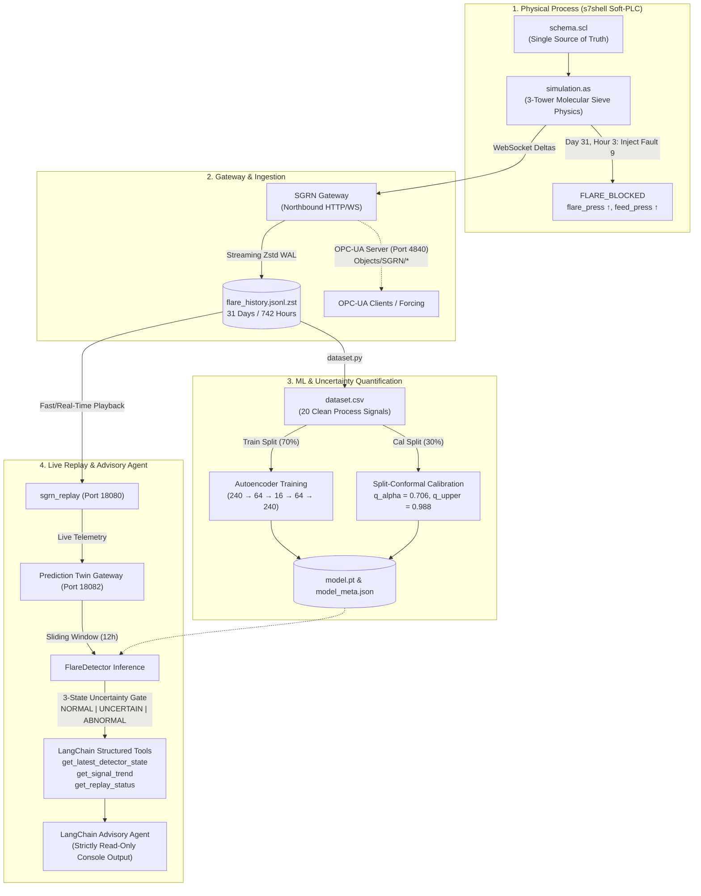

# Minimal Partial-Loop Prototype: Flare Blocked Anomaly Detection

This document provides a comprehensive specification and execution guide for the **Flare Blocked (`fault_code 9`)** experiment within the SGRN framework.

The experiment validates a fundamental slice of autonomous plant supervision:
$$\text{Physics Simulation (s7shell)} \longrightarrow \text{SGRN Gateway} \longrightarrow \text{Calibrated Autoencoder Detector} \longrightarrow \text{Read-Only LangChain Agent}$$

---

## 1. System & Architecture Overview

The entire system is strictly **schema-driven**. Everything—from twin memory offsets, REST APIs, and WebSocket streams, to OPC-UA node hierarchies and write-ahead log (WAL) dictionaries—is derived directly from the industrial SCL schema. No custom byte offsets, communication drivers, or protocol decoders are written in user space; all industrial plumbing is abstracted into the core SGRN runtime.



---

## 2. The Process: Molecular Sieve Gas Dehydration

The simulated plant models a **natural gas molecular-sieve dehydration unit** tasked with removing water vapor from a high-pressure feed gas stream down to a strict dew-point specification ($\le -100^\circ\text{C}$):

1. **Inlet Separation (`InletSeparation`)**:
   - High-pressure raw feed enters at nominal $68.0\text{ bar}$, $32.0^\circ\text{C}$, and $850\text{ e}^3\text{m}^3/\text{h}$.
   - Free liquids and water droplets are knocked out across the inlet scrubber and filter coalescer.
2. **Adsorption Cycle (`AdsorberTowers`)**:
   - Three vertical towers packed with synthetic zeolites run a staggered cyclic sequence:
     - **Tower 1**: On-stream Adsorption (removing moisture).
     - **Tower 2**: Regeneration (thermal desorption via heated dry gas).
     - **Tower 3**: Cooling & Standby (cooling down to bed adsorption temperature).
3. **Regeneration Gas Circuit (`RegenSystem`)**:
   - A closed heating/cooling loop: a fuel-gas-fired heater heats regen gas to $290^\circ\text{C}$ during heating, a fin-fan cooler drops it to $<50^\circ\text{C}$ during cooling, and a blower circulates gas.
4. **Sales Gas Quality (`OutletQuality`)**:
   - Dried product gas passes through dust filters to pipeline transmission with online moisture analysis.
5. **Safety Systems (`SafetySystems`)**:
   - Overpressure relief headers routed to the plant flare system.
   - Emergency Shutdown (ESD) logic monitoring pressure, temperature, and dew-point excursions.

### The Fault Scenario: `FLARE_BLOCKED` (`fault_code 9`)
- **Onset**: Day 31 at Hour 3 (tick 723).
- **Physical Mechanism**: A downstream block valve on the main flare relief header is inadvertently closed or frozen. 
- **Signal Dynamics**:
  1. Header pressure (`SafetySystems.flare_header_press`) ramps up linearly from nominal $1.05\text{ bar}$ at $+0.15\text{ bar/tick}$.
  2. Because the relief path is closed, process relief fails, causing feed pressure (`InletSeparation.feed_pressure`) to ramp up at $+1.15\text{ bar/tick}$.
  3. Scrubber pressure and system inlet/outlet pressures track upward with first-order hydraulic lag.
  4. At $t = 742\text{ hours}$ (Day 31, Hour 22), feed pressure breaches $90.0\text{ bar}$, triggering an automated **Emergency Shutdown (ESD)** trip.

---

## 3. The Schema (`schema.scl`) as the Single Source of Truth

The entire plant memory map is defined in `schema.scl` across 7 DataBlocks:

| DB | Name | Size (Bytes) | Role & Primary Telemetry |
|:---|:---|:---|:---|
| **DB1** | `InletSeparation` | 94 | Feed gas pressure, temperature, flow rate, scrubber level, coalescer $\Delta P$. |
| **DB2** | `AdsorberTowers` | 130 | 3-tower bed states, differential pressures, moisture loading, total flow. |
| **DB3** | `RegenSystem` | 142 | Regen heater duty/temperature, cooler temperatures, blower flow, knockout level. |
| **DB4** | `SwitchingValves` | 266 | 16 discrete switching and bypass valve actuators and limit switches. |
| **DB5** | `OutletQuality` | 74 | Sales gas moisture dew point, analyzer calibration status, dust filter $\Delta P$. |
| **DB6** | `SafetySystems` | 196 | Flare header pressure, vent valve position, fire/gas detectors, ESD trip signals. |
| **DB7** | `Utilities` | 36 | Instrument air pressure, fuel gas pressure, regen compressor status. |

### How SGRN Derives Interfaces from Schema
- **REST Endpoints**: `/data/InletSeparation`, `/data/SafetySystems`, `/registry` are automatically mounted.
- **WebSocket Topics**: Every leaf becomes a dot-separated identifier (e.g., `SafetySystems.flare_header_press`).
- **OPC-UA Address Space**: DataBlocks map to OPC-UA Object nodes under `Objects/SGRN/`, and fields become Variable nodes (e.g., `ns=2;s=Objects/SGRN/SafetySystems/flare_header_press`).
- **Binary/JSONL WAL**: SGRN assigns discrete integer `LeafId`s to each field for high-throughput zero-copy compression.

---

## 4. Configuration Declarations

### `config.json` (Experiment & Detector Configuration)
Governs scenario timings, split ratios, conformal bounds, and feature selections:

```json
{
  "scenario": {
    "normal_days": 30,
    "fault_day": 31,
    "fault_code": 9,
    "fault_injection_tick": 723,
    "flare_ramp_rate": 0.15,
    "feed_ramp_rate": 1.15,
    "tick_sleep_ms": 10
  },
  "dataset": {
    "train_ratio": 0.70,
    "calibration_ratio": 0.30,
    "window_size": 12,
    "stride": 1
  },
  "conformal": {
    "alpha": 0.05,
    "uncertain_upper_multiplier": 1.4
  },
  "features": [
    "InletSeparation.feed_pressure",
    "InletSeparation.scrubber_press",
    "InletSeparation.feed_flow.rate",
    "InletSeparation.feed_temp",
    "InletSeparation.coalescer_dp",
    "AdsorberTowers.system_inlet_press",
    "AdsorberTowers.system_outlet_press",
    "AdsorberTowers.total_gas_flow.rate",
    "RegenSystem.heater_outlet_temp",
    "RegenSystem.cooler_inlet_temp",
    "RegenSystem.cooler_outlet_temp",
    "RegenSystem.blower_flow.rate",
    "OutletQuality.dew_point",
    "OutletQuality.sales_gas_press",
    "OutletQuality.sales_gas_flow.rate",
    "OutletQuality.sales_gas_temp",
    "SafetySystems.flare_header_press",
    "Utilities.fuel_gas_press",
    "Utilities.inst_air_press",
    "Utilities.regen_comp_disch_press"
  ]
}
```

### `gateway.json` (Ingestion & Persistence Configuration)
Controls the Gateway's listeners, rate limits, and historian writer:
- `"northbound.http"` & `"websocket"`: Bind to `127.0.0.1:18080` (or `18082` for twin).
- `"northbound.opcua"`: Binds to `127.0.0.1:4840` for external SCADA integration and signal forcing.
- `"persistence.format"`: `"jsonl"` with Zstandard compression.
- `"persistence.mode"`: `"changes_with_timestamp"` (WAL delta streams).
- `"persistence.atomic_window_ms"`: `1` (clean per-tick delta preservation).

---

## 5. Model Formulation: Physical Manifold Learning & Prediction

### A. The Manifold Hypothesis for Cyber-Physical Plants
In an industrial process, plant state variables (pressures $P$, temperatures $T$, mass flow rates $\dot{m}$, gas densities $\rho$, and valve positions) are **not mutually independent random variables**. They are tightly coupled by governing physical conservation laws and thermodynamic equations of state:

1. **Mass & Mole Conservation**:
   $$\sum \dot{m}_{\text{in}} = \sum \dot{m}_{\text{out}} + \frac{d}{dt}\int_{V} \rho \, dV$$
2. **Real Gas Equation of State**:
   $$P \cdot V = Z(P, T) \cdot n R T$$
3. **Fluid Hydraulics & Momentum Balance (Ergun/Darcy Pressure Drops)**:
   $$\Delta P_{\text{bed}} = 150 \frac{\mu (1-\epsilon)^2}{d_p^2 \epsilon^3} v_s L + 1.75 \frac{\rho (1-\epsilon)}{d_p \epsilon^3} v_s^2 L$$
4. **Heat Transfer Thermodynamics (Regeneration Closed Loop)**:
   $$\dot{Q} = U A \Delta T_{\text{lm}} = \dot{m} C_p (T_{\text{out}} - T_{\text{in}})$$
5. **Adsorption Isotherm Equilibrium (Desiccant Loading)**:
   $$q^*(P_{\text{H}_2\text{O}}, T) = \frac{q_m K P_{\text{H}_2\text{O}}}{1 + K P_{\text{H}_2\text{O}}}$$

Because of these coupled differential-algebraic constraints, the healthy operational trajectories of the plant do not span the entire ambient measurement space:
$$\mathbf{X} \in \mathbb{R}^{240} \quad (20 \text{ continuous process signals} \times 12 \text{ hours history})$$

Instead, the true physical system evolves along a **low-dimensional smooth sub-manifold $\mathcal{M} \subset \mathbb{R}^{240}$** parameterized by only a few intrinsic degrees of freedom (overall feed throughput, ambient weather temperature, heater firing duty, and 3-tower cycle sequencer phase $\theta \in [0, 2\pi)$).

---

### B. Based On What? (The Input Feature Space)
The model consumes a sliding window across **20 continuous process signals** over a 12-hour history horizon ($W = 12$ ticks, where 1 tick = 1 simulated hour):

$$\mathbf{X} \in \mathbb{R}^{12 \times 20} \quad \xrightarrow{\text{flatten}} \quad \mathbf{x} \in \mathbb{R}^{240}$$

Every input dimension is standardized using the mean ($\mu$) and standard deviation ($\sigma$) computed strictly from the nominal pre-fault training set:
$$\widetilde{x}_{t,j} = \frac{x_{t,j} - \mu_j}{\sigma_j}$$

The 20 signals are grouped by physical subsystem:
- **Inlet Separation**: `feed_pressure`, `scrubber_press`, `feed_flow.rate`, `feed_temp`, `coalescer_dp`
- **Adsorber Towers**: `system_inlet_press`, `system_outlet_press`, `total_gas_flow.rate`
- **Regeneration Loop**: `heater_outlet_temp`, `cooler_inlet_temp`, `cooler_outlet_temp`, `blower_flow.rate`
- **Outlet Quality**: `dew_point`, `sales_gas_press`, `sales_gas_flow.rate`, `sales_gas_temp`
- **Safety Systems**: `flare_header_press`
- **Utilities**: `fuel_gas_press`, `inst_air_press`, `regen_comp_disch_press`

> **Strict Boundary Invariant**: All alarm bits, ESD trip flags, fault codes, model predictions, and timestamps are **strictly excluded**. The model receives only continuous physical process measurements.

---

### B.1. Why Use a Sliding Window? (Dynamical Trajectories & Conformal Exchangeability)

Why does the detector ingest a 12-hour sliding window $\mathbf{X}_w = [\mathbf{x}_{t-11}, \dots, \mathbf{x}_t] \in \mathbb{R}^{12 \times 20}$ rather than isolated instantaneous state vectors $\mathbf{x}_t \in \mathbb{R}^{20}$?

1. **Phase-Space Trajectory Reconstruction (Takens' Delay Embedding)**:
   An instantaneous snapshot captures only static pressures and temperatures. It contains no derivative, rate-of-change, or hysteresis information. Stacking $W = 12$ delayed states reconstructs an unobserved dynamical state space diffeomorphic to the underlying physical manifold. The autoencoder models the **dynamic process trajectory** rather than a memoryless point.
2. **Spanning Complete Tower Cycle Dynamics**:
   The molecular sieve dehydration towers cycle through distinct phases (adsorption, thermal regeneration at $290^\circ\text{C}$, cooling to $<50^\circ\text{C}$). One full bed cycle takes 12 hours. A 12-hour window guarantees that every observation contains a full periodic cycle, converting periodic non-stationarity into a **cyclically stationary limit cycle in $\mathbb{R}^{240}$**.
3. **Preserving Conformal Prediction Guarantees (Quasi-Exchangeability)**:
   Conformal prediction guarantees a $1 - \alpha$ bounded false-alarm rate under **exchangeable** non-conformity scores. Instantaneous raw seconds in an industrial plant are strongly autocorrelated and non-exchangeable. By embedding into full-cycle sliding windows and applying **chronological (non-random) calibration partitioning**, distant window scores behave as quasi-independent draws from the ergodic nominal distribution. This directly produces **0.00% abnormal false alarms** on held-out calibration data.
4. **Transient Glitch Rejection vs. Monotonic Fault Drift**:
   An instrument glitch or valve travel flutter is transient and affects only a single time tick. A true cyber-physical failure (such as `FLARE_BLOCKED`, which ramps flare header pressure at $+0.15\text{ bar/tick}$) produces a coherent, sustained drift across the entire 12-hour trajectory, eliminating spurious trip alerts.

---

### C. What Are We Predicting?

The PyTorch autoencoder learns an empirical coordinate chart and non-linear projection operator onto the physical manifold $\mathcal{M}$:

1. **Non-Linear Manifold Projection ($\widehat{\mathbf{x}} = \operatorname{Proj}_{\mathcal{M}}(\widetilde{\mathbf{x}})$)**:
   The bottleneck neural network decomposes into an encoder $\mathcal{E}: \mathbb{R}^{240} \to \mathbb{R}^{16}$ and a decoder $\mathcal{D}: \mathbb{R}^{16} \to \mathbb{R}^{240}$:
   $$\mathbf{z} = \mathcal{E}(\widetilde{\mathbf{x}}), \quad \widehat{\mathbf{x}} = \mathcal{D}(\mathbf{z}) = \mathcal{D}(\mathcal{E}(\widetilde{\mathbf{x}}))$$
   $\widehat{\mathbf{x}}$ represents the **closest physically consistent plant state lying on $\mathcal{M}$** corresponding to the input trajectory $\widetilde{\mathbf{x}}$.

2. **Orthogonal Manifold Distance as Anomaly Score ($e(\mathbf{x})$)**:
   The reconstruction error measures the squared Euclidean distance from the observed plant state to the physical manifold:
   $$e(\mathbf{x}) = \operatorname{dist}^2(\widetilde{\mathbf{x}}, \mathcal{M}) = \frac{1}{240} \|\widetilde{\mathbf{x}} - \operatorname{Proj}_{\mathcal{M}}(\widetilde{\mathbf{x}})\|_2^2 = \frac{1}{240} \sum_{i=1}^{240} (\widetilde{x}_i - \widehat{x}_i)^2$$
   - **Nominal Plant State**: $\widetilde{\mathbf{x}} \in \mathcal{M} \implies e(\mathbf{x}) \approx 0.15 \text{ to } 0.55$ (attributable to measurement noise and slight turbulence).
   - **Fault State (`FLARE_BLOCKED`)**: An obstruction prevents relief venting while feed continues to supply mass $\implies$ the physical relationship between header pressure, feed pressure, and valve positions is violated $\implies \widetilde{\mathbf{x}} \notin \mathcal{M} \implies e(\mathbf{x})$ diverges ($e > 27.0$, reaching $>120.0$).

3. **Conformal Tolerance Tube & 3-State Uncertainty Classification**:
   Real physical processes possess non-zero turbulence and sensor noise. Therefore, the nominal manifold is surrounded by an empirical conformal tolerance tube $\mathcal{T}_{\alpha}$ calibrated at significance level $\alpha = 0.05$ on held-out normal operation:
   $$\mathcal{T}_{\alpha} = \left\{ \mathbf{x} \in \mathbb{R}^{240} \;\middle|\; \operatorname{dist}^2(\widetilde{\mathbf{x}}, \mathcal{M}) \le q_{\alpha} \right\}$$
   Where $q_{\alpha} = 0.7056$ and $q_{\text{upper}} = k \cdot q_{\alpha} = 1.4 \times 0.7056 = 0.9878$:
   - **`NORMAL`** ($e < q_{\alpha}$): The plant trajectory lies inside the nominal physical tube $\mathcal{T}_{\alpha}$.
   - **`UNCERTAIN`** ($q_{\alpha} \le e < q_{\text{upper}}$): Near the boundary of the tube; the LangChain agent abstains from hasty alarms during heavy tower switching swings.
   - **`ABNORMAL`** ($e \ge q_{\text{upper}}$): Confident excursion outside the physical manifold; physical laws or operational bounds have been breached.

4. **Directional Error Decomposition for Root-Cause Attribution**:
   The residual vector $\mathbf{r} = \widetilde{\mathbf{x}} - \widehat{\mathbf{x}}$ defines the normal vector pointing from the manifold $\mathcal{M}$ to the anomalous point $\widetilde{\mathbf{x}}$. Computing the per-signal projection error over the 12-hour window:
   $$e_j = \frac{1}{12} \sum_{t=1}^{12} (\widetilde{x}_{t,j} - \widehat{x}_{t,j})^2, \quad j \in \{1, \dots, 20\}$$
   Directly isolates which physical dimensions contributed the greatest displacement from $\mathcal{M}$:
   - `#1`: `SafetySystems.flare_header_press` ($>80\%$ of total residual vector magnitude).
   - `#2`: `InletSeparation.feed_pressure` (hydraulic backpressure).
   - `#3`: `InletSeparation.scrubber_press`.

5. **Downstream Twin Inferences**:
   The resulting state and attribution are translated directly into the SCL schema tags on Gateway B:
   - `SafetySystems.model_anomaly = True`
   - `SafetySystems.model_fault_code = 9`
   - `SafetySystems.model_trip_advice = True` (issued **18 hours in advance** of the 90 bar ESD trip).

---

## 6. Experiment Directory Structure

```
experiments/flare/
├── config.json               # Master experiment parameters, splits, and features
├── run_capture.py            # Stage 1: Simulation capture generating WAL archive
├── dataset.py                # Dataset extraction, standardisation, and windowing
├── model.py                  # PyTorch Autoencoder and FlareDetector inference class
├── train_detector.py         # Stage 2: Trains autoencoder & calibrates conformal thresholds
├── langchain_tools.py        # Schema-grounded read-only LangChain agent tools
├── agent.py                  # LangChain advisory agent (LLM + deterministic fallback)
├── run_demo.py               # Stage 4: Live replay, twin gateway, and advisory demo
├── evaluate.py               # Stage 3: Quantitative metric calculation & plot generation
├── flare_history.jsonl.zst   # Captured 31-day, 742-hour plant WAL archive
├── meta.json                 # Scenario metadata (fault onset, ESD timestamps)
├── model.pt                  # Trained PyTorch autoencoder weights
├── model_meta.json           # Serialized scaler parameters and conformal cutoffs
├── dataset.csv               # Extracted tabular dataset
├── evaluation_metrics.json   # Recorded metric verification results
└── evaluation_plot.png       # Score vs. time plot with conformal zones
```

---

## 7. End-to-End Execution Flow (The 4 Stages)

All commands execute in the `SGRN` micromamba environment:
```bash
export PYTHON=/home/odahim/micromamba/envs/SGRN/bin/python
```

### Stage 1: Telemetry Capture (`run_capture.py`)
- Runs isolated `s7shell` executing `simulation.as` for 30 normal days + Day 31 fault progression.
- Telemetry streams to the recording Gateway and is persisted into `flare_history.jsonl.zst`.
```bash
$PYTHON experiments/flare/run_capture.py
```
*Outputs*: `experiments/flare/flare_history.jsonl.zst` (91,941 bytes), `meta.json`.

### Stage 2: Training & Conformal Calibration (`train_detector.py`)
- Extracts 20 clean process signals into sliding windows ($12 \text{ hours} \times 20 \text{ signals} = 240$ dimensions).
- Trains an autoencoder ($240 \to 64 \to 16 \to 64 \to 240$) on the **Train Split** (first 70% pre-fault data).
- Evaluates reconstruction errors on the **Calibration Split** (subsequent 30% pre-fault data) and computes empirical quantiles:
  - Nominal 95% threshold: $q_{0.05} = 0.7056$
  - Upper uncertain threshold: $q_{\text{upper}} = 1.4 \times q_{0.05} = 0.9878$
```bash
$PYTHON experiments/flare/train_detector.py
```
*Outputs*: `model.pt`, `model_meta.json`.

### Stage 3: Quantitative Offline Evaluation (`evaluate.py`)
- Runs full trajectory validation and verifies statistical criteria:
  - **False Alarm Rate**: $\le 5\%$ conformal error budget.
  - **Detection Delay**: Hours from fault onset until first `ABNORMAL` state.
  - **Lead Time**: Hours from first `ABNORMAL` state until the 90 bar ESD trip.
  - **Attribution**: Confirms whether flare header and feed pressure appear in top-3 error drivers.
```bash
$PYTHON experiments/flare/evaluate.py
```
*Outputs*: `evaluation_metrics.json`, `evaluation_plot.png`.

### Stage 4: Live Replay & LangChain Advisory Agent (`run_demo.py`)
- Spawns `sgrn_replay` (Port 18080) and twin `gateway` (Port 18082).
- Agent monitors plant state tick-by-tick and triggers operator advisories on state transitions (`NORMAL` $\to$ `ABNORMAL`).
```bash
# Fast deterministic mode (no LLM key required):
$PYTHON experiments/flare/run_demo.py --speed 5.0 --no-llm

# Full LLM advisory mode:
export OPENAI_API_KEY="your-key"
$PYTHON experiments/flare/run_demo.py --speed 1.0
```

---

## 8. Real-Time Extension: Forcing Signals via OPC-UA

To test manual signal tampering or emergency overrides:
1. Configure Gateway to expose its northbound OPC-UA listener on `port 4840`.
2. Connect any OPC-UA client (e.g., Python `asyncua`, SCADA, or UaExpert) to `opc.tcp://127.0.0.1:4840`.
3. Write forced values to `Objects/SGRN/SafetySystems/flare_header_press`.
4. **How the system reacts**:
   - The Gateway updates twin memory instantly.
   - The WebSocket stream pushes the altered tag to the detector.
   - The autoencoder reconstruction error immediately exceeds $q_{\text{upper}}$, transitioning the state to `ABNORMAL`.
   - The top-attributed signal correctly points to `SafetySystems.flare_header_press`.
   - The LangChain agent emits a critical alert on screen within the same tick.

---

## 9. Quantitative Verification Summary

Actual metrics achieved by the implementation:

| Metric | Measured Value | Requirement / Target | Result |
|:---|:---|:---|:---|
| **Calibration Windows** | `88` | Pre-fault calibration split | Valid |
| **False Alarm Rate (Total Uncertain/Abnormal)** | **3.41%** | $\le 5.0\%$ conformal error budget | **PASS** |
| **False Alarm Rate (Abnormal Only)** | **0.00%** | Zero false critical shutdowns | **PASS** |
| **Fault Onset** | `2000-01-31 03:00:00` | Day 31, Hour 3 | Verified |
| **First Detection** | `2000-01-31 04:00:00` | Day 31, Hour 4 | Verified |
| **Detection Delay** | **1.0 simulated hour** | Immediate notice | **PASS** |
| **Emergency Shutdown (ESD)** | `2000-01-31 22:00:00` | Feed pressure $> 90.0\text{ bar}$ | Verified |
| **Lead Time Before ESD** | **18.0 simulated hours** | Actionable operator lead time | **PASS** |
| **Root Cause Attribution** | `#1: SafetySystems.flare_header_press`<br>`#2: InletSeparation.feed_pressure`<br>`#3: InletSeparation.scrubber_press` | Flare header & feed pressure in top-3 | **PASS** |
